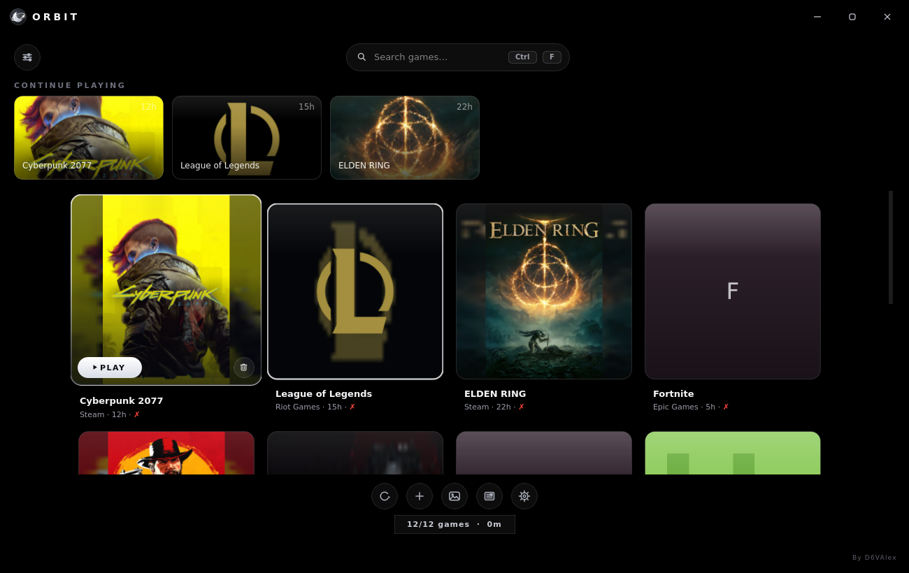
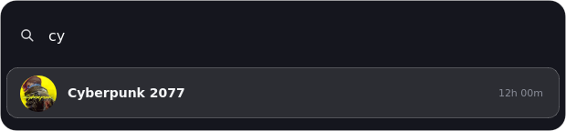
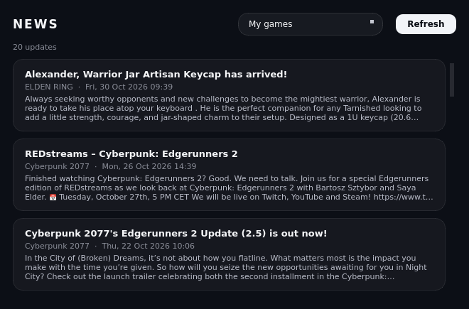
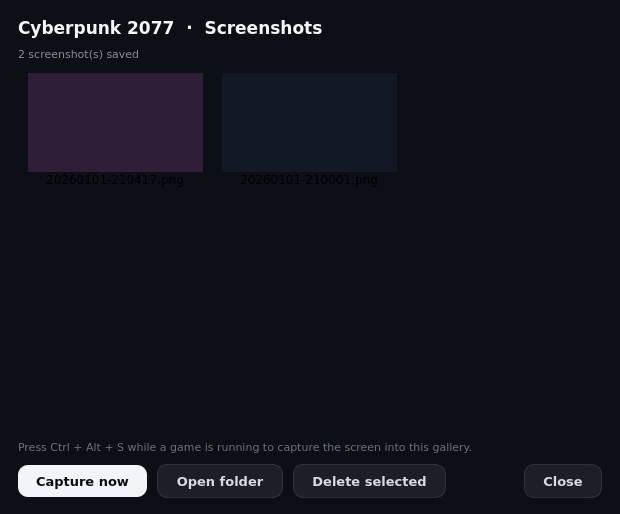
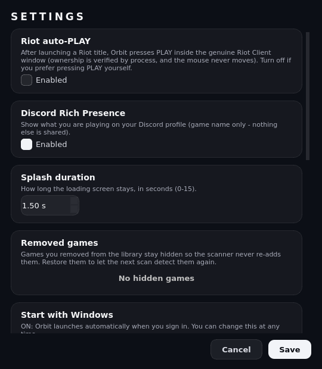

# Orbit Launcher

Orbit is a Windows game launcher that finds the games already installed on your PC and gathers them in one fast, good looking library. It is made by D6VAlex.

## Screenshots

| Quick launcher (Ctrl + Alt + Space) | News for your games |
| --- | --- |
|  |  |
| **Screenshot gallery** | **Settings** |
|  |  |

## Features

1. One library for your games. Orbit detects installed games from Steam, Epic Games, EA App, Ubisoft Connect, GOG Galaxy, Battle.net, Riot Games, Rockstar, Bethesda, Minecraft, Roblox, itch.io, Amazon Games and HoYoPlay.
2. Quick launcher. A global hotkey (Ctrl + Alt + Space by default, changeable in Settings) opens a small search box above everything: type a game name, press Enter, it starts - even when Orbit is in the background. Ctrl + Space does the same inside the main window.
3. Playtime tracking. Session time is recorded automatically for every game, Steam playtime history can be imported, and the library chip shows your total hours plus what you played this week.
4. Weekly playtime goal. Set a soft target in Settings and the stats line shows your progress; Orbit celebrates once when you reach it.
5. Continue Playing. The last games you played wait in a row at the top of the library, one click away.
6. Full keyboard and gamepad control. Arrow keys or a controller (left stick / D-pad, A to launch, B to clear) walk the library, Enter launches, and typing jumps into search.
7. Per-game launch options and tags. Every game can get its own launch arguments (Steam-style), an optional run-as-administrator switch, and free-text tags (FPS, Co-op, Story...) right from Properties.
8. Tag filtering. The sort menu lists every tag used in the library with live counts; tick one or more to filter the grid, and the choice is remembered.
9. Screenshot gallery. Ctrl + Alt + S while a game is running captures the screen into that game's gallery; browse thumbnails, capture, open the folder or delete from one dialog.
10. Gaming news. A news dialog pulls patch notes for your Steam games straight from the official feeds, plus IGN and PC Gamer headlines, with an offline cache.
11. Game properties. Playtime, launch count, last session, install folder and executable path for every game in one dialog.
12. Sort and filter. Order the library by favorites, last played, most played or name, and show all games or favorites only; the choice is remembered.
13. Discord Rich Presence. The current game is shown on your Discord profile, with a switch to turn it off.
14. Cover art. Covers come from a safe, strictly filtered image chain, and every game can get a custom cover from a local file.
15. Cloud sync (backup). Point Orbit at a folder inside OneDrive, Google Drive or Dropbox and it keeps a small orbit-profile.json there: the whole library, playtime history, tags, launch options and app settings. Restore on another PC with replace-or-merge, sync automatically or on demand. No account, no server, your data stays yours.
16. In-app updates. Orbit checks a manifest, can download the new installer itself, verifies its SHA-256 checksum before running it, and always offers the download page instead.
17. Start with Windows. The first run adds Orbit to Windows startup and tells you about it; the Settings dialog can turn it off at any time. The window also remembers its size and position.
18. Real close button. Closing the window truly exits the app - no processes stay behind in the background. Games you remove from the library stay removed: the scanner never re-adds them (restorable from Settings).
19. Fast startup. A light splash screen, cards that stream in as games are found, and a trimmed build that starts quickly.
20. Aurora Glass interface. The pure black backdrop stays perfectly still (a custom background can still be picked from the gallery button), PS5-style game tiles that pop with a smooth zoom and show the complete cover art, glass surfaces in a monochrome Lunar Glass language, and a friendly empty-library state.

## Getting the app

1. Open the Releases page of this project.
2. Download the Orbit Setup installer or the portable ZIP.
3. Run the installer, or extract the ZIP and start Orbit.exe.

## Running from source

1. Install Python 3.11 or newer.
2. Install the dependencies: pip install PySide6 psutil
3. Start the app: python main.py

## Updates

Orbit checks a small JSON file (latest.json) on GitHub and tells you when a new version is published. You can download the installer from inside the app - the download is verified against the SHA-256 checksum written in latest.json before anything runs - or just open the releases page. Publishing a new version means: upload the new Setup EXE to a GitHub release, compute its SHA-256, and update version, url and sha256 in latest.json.

## Project layout

main.py: application entry point
build.py: build script for the EXE, the portable ZIP and the installer
installer.iss: Inno Setup script used by build.py
latest.json: update manifest read by the updater
core/: settings, database, tray, updater, gamepad, global hotkeys, screenshots, news feeds, cloud sync, Discord RPC and process tracking
parsers/: one module per game platform
ui/: window, styles, cards, quick launcher overlay, gallery, news, dialogs and the logo
utils/: Windows helpers such as EXE icon extraction

## Changelog

1.1.1: Bug-fix release. Games that share one install folder no longer overwrite each other in the library, games you have played are never removed automatically even if their files vanish temporarily (the scan only clears true orphans), the library is restored from the local database whenever a scan finds nothing, and closing the window now always terminates the process within seconds. The Actions workflow also publishes the update manifest (latest.json) to main automatically after each release.
1.1.0: Orbit rebrand with the new Aurora Glass interface on a pure black backdrop, a monochrome crescent-moon orbit logo and an updated installer. This build adds the quick launcher with a global hotkey, per-game tags with library filtering, a screenshot gallery with a capture hotkey, a gaming-news dialog (official Steam patch notes plus IGN and PC Gamer headlines), a weekly playtime goal with a one-time celebration, cloud sync backups to any OneDrive/Dropbox/Google Drive folder with replace-or-merge restore, Continue Playing, weekly playtime in the library chip, full keyboard and gamepad navigation, per-game launch arguments with run-as-admin, a game properties dialog, sort and filter modes, scan-finished notifications, in-app update download with SHA-256 verification, automatic Windows startup with a Settings switch, window position memory, and an empty-library welcome state.

## Credits and license

Orbit is made by D6VAlex. All rights reserved.
